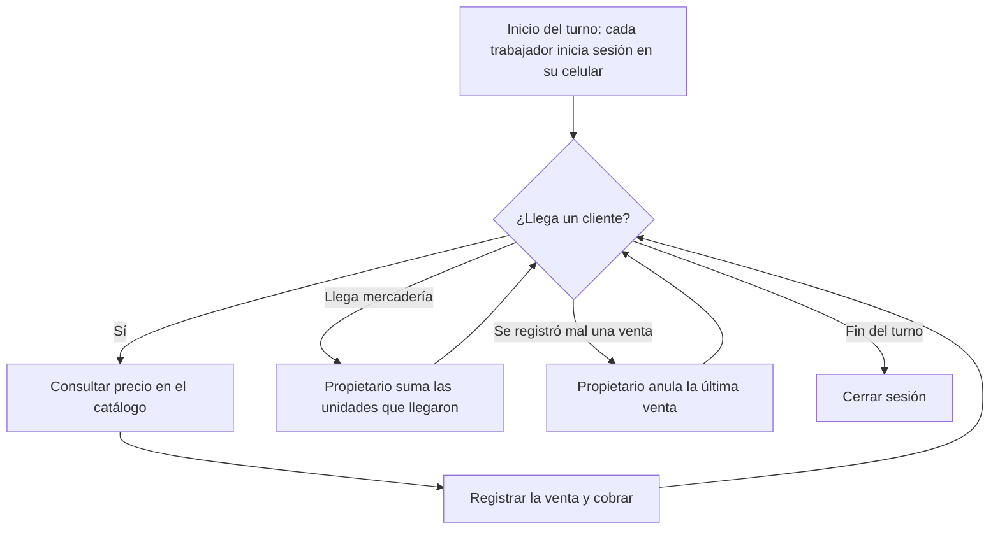
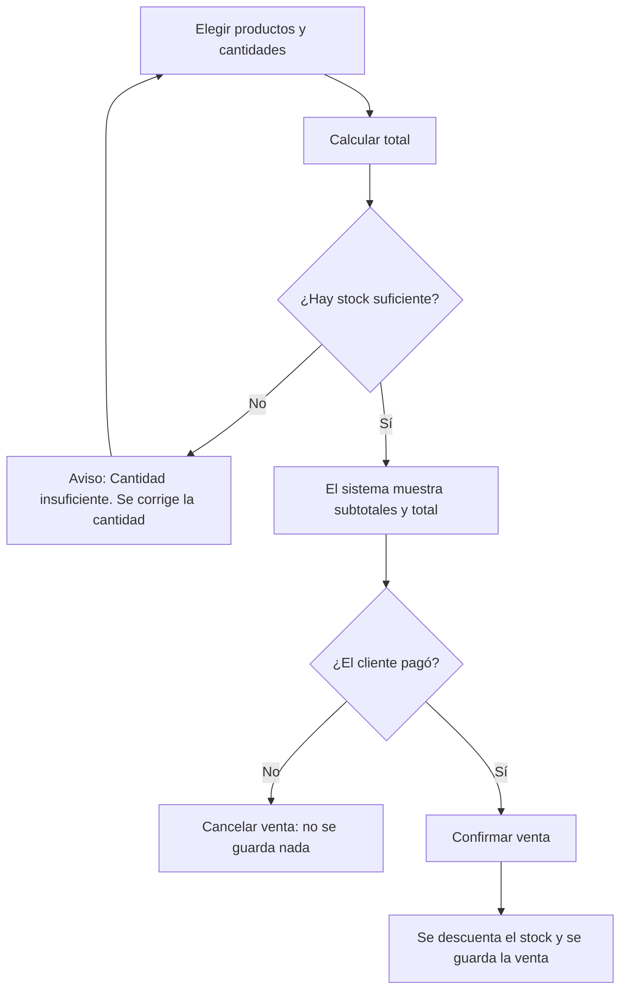

# Flujo del negocio con el sistema

Este documento cuenta, paso a paso, cómo se trabaja en Minimarket A&J con el sistema: qué hace cada persona, qué responde el sistema y qué pasa cuando algo sale distinto de lo normal. Para la parte técnica del proyecto, ver [PROYECTO.md](PROYECTO.md).

---

## 1. Cómo era antes del sistema

1. El cliente pide un producto o lo toma del estante.
2. El vendedor busca el precio: en la etiqueta (a veces borrosa), en su memoria o preguntando al propietario.
3. Suma el total a mano o con una calculadora y cobra en efectivo, Yape o Plin.
4. La venta **no queda registrada** en ningún lado y el stock **no se actualiza**.
5. El propietario se entera de que algo se acabó cuando ve el estante vacío.

El sistema reemplaza los pasos 2, 3 y 4, y le da al propietario información para el paso 5.

## 2. Las personas que participan

- **Cliente:** compra los productos. No usa el sistema.
- **Vendedor:** atiende al cliente. En el sistema consulta precios y registra ventas.
- **Propietario:** además de vender, fija los precios, controla las cantidades, revisa el historial y corrige ventas mal registradas.

## 3. Un día en la tienda (vista general)

## 4. Flujos detallados

### 4.1 Iniciar sesión (CUS01)

1. El trabajador abre el sistema en el navegador del celular.
2. Escribe su usuario y contraseña, y pulsa **Ingresar**.
3. El sistema revisa los datos y abre el **Catálogo**. En la cabecera aparece su rol: **V** (vendedor) o **P** (propietario).
4. El menú inferior muestra solo lo que ese rol puede usar:
   - Vendedor: **Catálogo** y **Vender**.
   - Propietario: **Catálogo**, **Vender** e **Historial**, y en cada producto los botones **Cambiar precio** y **Cambiar cantidad**.

**Si algo sale mal:** si el usuario o la contraseña no coinciden, aparece *"Error: Usuario o contraseña incorrectos."*. El usuario escrito se conserva para corregir solo la contraseña.

**Al terminar el turno:** el trabajador pulsa **Cerrar sesión**, para que el siguiente pueda entrar con su propia cuenta en el mismo celular.

### 4.2 Consultar un precio (CUS02)

1. El vendedor escribe en **Buscar producto** una parte del nombre. Ejemplo: "arroz" o "1 kg".
2. El sistema muestra los productos que coinciden, ordenados por nombre, con su **precio** y la cantidad **disponible**.
3. El vendedor le dice el precio al cliente.

**Si no hay coincidencias:** aparece *"No se encontraron productos."* y se puede buscar otra vez. El enlace **Ver todos los productos** vuelve a la lista completa.

### 4.3 Registrar una venta (CUS04 + CUS05)

1. En **Vender**, el vendedor escribe parte del nombre del producto y lo elige de la lista. El sistema le muestra su precio y cuántas unidades hay.
2. Escribe la **cantidad** que lleva el cliente. Con **+ Agregar otro producto** añade más productos a la misma venta.
3. Pulsa **Calcular total**. El sistema revisa que haya unidades suficientes y muestra la pantalla **Confirmar venta** con el precio unitario, el subtotal de cada producto y el **total a cobrar**.
4. El vendedor cobra: recibe el efectivo o revisa en su celular la confirmación de Yape o Plin.
5. Si el pago está bien, pulsa **Confirmar venta**. El sistema, en un solo paso:
   - descuenta las unidades vendidas del stock (CUS05), y
   - guarda la venta en el historial con su fecha y hora.
6. Aparece *"Listo: La venta se registró correctamente."* y el formulario queda listo para la siguiente venta.

**Si algo sale distinto:**

- **No alcanza el stock:** si se piden 11 detergentes y solo hay 10, aparece *"Error: Cantidad insuficiente de Detergente 900 g. Unidades disponibles: 10."*. No se cobra nada y los productos elegidos se conservan para corregir la cantidad.
- **El cliente no paga o se arrepiente:** se pulsa **Cancelar venta**. Aparece *"Listo: La venta no se registró."* y el stock no cambia.
- **Dos vendedores venden lo último al mismo tiempo:** solo se registra la primera venta que se confirma. La otra recibe el aviso de cantidad insuficiente y no se guarda.
- **El vendedor se va a otra pantalla sin terminar:** al volver a **Vender**, el sistema recupera la venta que estaba armando (*"Se recuperó la venta que estabas registrando."*). Este borrador se guarda solo en esa pestaña del navegador y para ese usuario.

> **Importante:** el total siempre se calcula con el precio guardado en el sistema. El vendedor no puede cambiar el precio al cobrar.

### 4.4 Cambiar un precio (CUS03, solo propietario)

1. En el **Catálogo**, el propietario pulsa **Cambiar precio** en el producto.
2. Ve el precio actual y escribe el nuevo (mayor que 0 y con hasta 2 decimales, por ejemplo 4.80).
3. Pulsa **Guardar precio**. Aparece *"Listo: El precio se actualizó correctamente."*.
4. Desde ese momento, todas las consultas y ventas usan el precio nuevo.

**Si se arrepiente:** pulsa **Cancelar** y el precio no cambia.

### 4.5 Llegó mercadería o se contó el stock (CUS07, solo propietario)

1. En el **Catálogo**, el propietario pulsa **Cambiar cantidad** en el producto. Ve la cantidad disponible actual.
2. Tiene dos opciones:
   - **Llegó mercadería:** escribe las **unidades que llegaron** y pulsa **Sumar unidades**. El sistema las suma.
     *Ejemplo:* había 28 bolsas de arroz y llegaron 12 → *"Listo: Arroz 1 kg: se registró el ingreso de 12 unidades. Disponible: 40."*
   - **Corregir la cantidad:** si contó el producto en los estantes y la cantidad real es otra (por ejemplo, por productos dañados), escribe la **cantidad contada** y pulsa **Guardar cantidad contada**. El sistema reemplaza la cantidad.
     *Ejemplo:* el sistema decía 10 detergentes, pero hay 8 → *"Listo: Detergente 900 g: la cantidad disponible se ajustó a 8."*

**Si el dato no es válido:** las unidades que llegan deben ser mayores que 0 y la cantidad contada no puede ser negativa. Si no se cumple, aparece el error (por ejemplo, *"Error: Las unidades que llegaron deben ser mayores que cero."*) y la cantidad no cambia.

### 4.6 Revisar el historial de ventas (CUS06, solo propietario)

1. El propietario abre **Historial**.
2. Ve todas las ventas en orden cronológico (de la más antigua a la más reciente). Cada una muestra su número, fecha y hora, productos, cantidades, subtotales y total.
3. Las ventas anuladas aparecen con la etiqueta **Anulada**, la fecha de anulación y el motivo.

**Si todavía no hay ventas:** aparece *"Todavía no hay ventas registradas."*.

### 4.7 Corregir una venta mal registrada (CUS08, solo propietario)

Solo se puede anular **la última venta registrada**. Así, las ventas anteriores nunca se modifican.

1. En **Historial**, la última venta muestra el botón **Anular venta**.
2. El sistema muestra los productos y el total de esa venta, y explica que la acción no se puede deshacer.
3. El propietario escribe el **motivo** (por ejemplo, *"Se registró 2 veces el arroz"*) y pulsa **Anular venta**.
4. El sistema, en un solo paso:
   - marca la venta como **anulada** y guarda la fecha y el motivo, y
   - devuelve sus unidades al stock.
5. Aparece *"Listo: La venta N.° 2 se anuló y sus unidades volvieron al inventario."*.
6. Si en realidad el cliente compró otra cosa, se registra una venta nueva con lo correcto.

**Si algo sale distinto:**

- **Se intenta anular una venta que no es la última** (por ejemplo, escribiendo su dirección): aparece *"Error: Solo se puede anular la última venta registrada."* y no cambia nada.
- **No se escribe el motivo:** aparece *"Error: Escribe el motivo de la anulación."* y la venta no se anula.
- **El propietario se arrepiente:** pulsa **Cancelar** y la venta queda igual.

### 4.8 Intentar usar una función que no corresponde

Si un vendedor intenta abrir una función del propietario (por ejemplo, escribiendo a mano la dirección del historial), el sistema muestra **"Acceso no permitido"** con *"Error: esta función es exclusiva del propietario."*. El control se hace en el servidor, no solo ocultando botones.

## 5. Ejemplo completo de un día

Con los datos de prueba del script:

| Momento | Quién | Qué hace | Resultado en el sistema |
|---|---|---|---|
| 7:00 | Joaquín (vendedor) | Inicia sesión | Ve Catálogo y Vender |
| 7:10 | Joaquín | Vende 2 Arroz 1 kg (S/ 4.50 c/u) y 1 Gaseosa 1.5 L (S/ 7.50) | Total S/ 16.50. Arroz: 30 → 28 |
| 9:00 | Sebastián (propietario) | Llegan 12 bolsas de arroz: **Cambiar cantidad** → suma 12 | Arroz: 28 → 40 |
| 9:30 | Sebastián | Cuenta los detergentes: hay 8, no 10 | Ajusta la cantidad a 8 |
| 10:00 | Sebastián | Vende 8 aceites (S/ 9.90 c/u), pero el cliente los devuelve antes de salir | Aceite: 15 → 7. Anula la venta (es la última) con el motivo y el aceite vuelve a 15 |
| 22:55 | Joaquín | Cierra sesión | El celular queda listo para otro trabajador |
| Noche | Sebastián | Revisa el **Historial** | Ve la venta de S/ 16.50 y la de S/ 79.20 marcada como "Anulada", con su motivo |

## 6. Qué pasa "por dentro" cuando se confirma una venta

Para quien quiera entender el recorrido técnico, explicado de forma simple:

1. El celular envía los productos y cantidades al **controlador** de ventas (`VentaControlador`).
2. El controlador se los pasa al **servicio** de ventas (`VentaServicio`), que vuelve a buscar el precio de cada producto en la base de datos y calcula el total.
3. El servicio le pide al **servicio de inventario** (`InventarioServicio`) que descuente las unidades.
4. Luego guarda la venta y sus detalles mediante los **DAO** (`VentaDAO` y `DetalleVentaDAO`), que son los únicos que escriben en MySQL.
5. Todo esto ocurre en una **transacción**: si cualquier paso falla, la base de datos deshace todo y queda como estaba.

La anulación de la última venta sigue el mismo camino, pero al revés: marca la venta como anulada y devuelve las unidades, también en una sola transacción.

## 7. Reglas del negocio en resumen

- Todos ven los mismos precios: los fija el propietario y el sistema los aplica al cobrar.
- Cada venta descuenta el stock automáticamente; el stock nunca queda en negativo.
- Una venta solo se guarda cuando el vendedor confirma que el cliente pagó.
- Solo el propietario cambia precios y cantidades, ve el historial y anula ventas.
- Solo se anula la última venta, siempre con un motivo, y nunca se borra: queda en el historial como "Anulada".
- Los productos nuevos y los usuarios se cargan directamente en la base de datos (el sistema todavía no tiene pantallas para eso).
